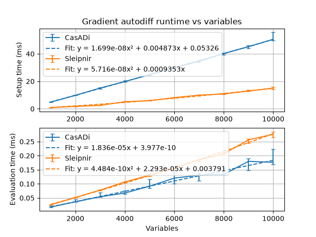
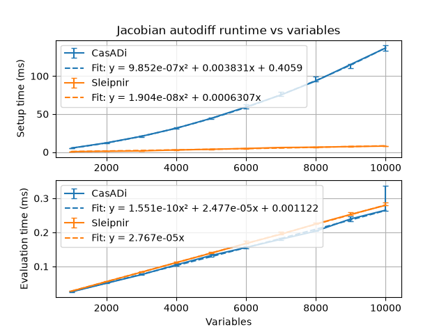
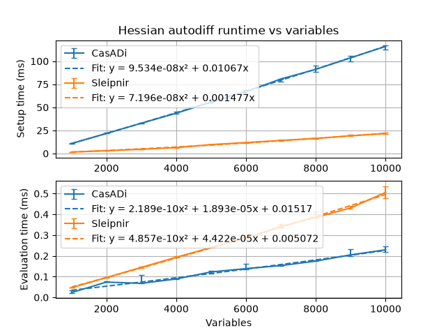
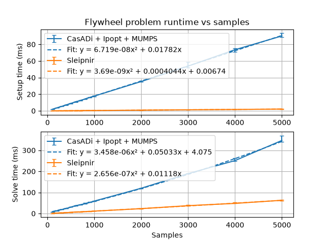
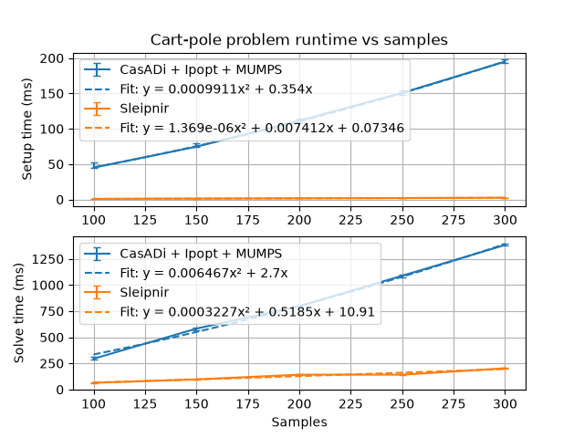

# Benchmarks

The benchmarks use [Google Benchmark](https://github.com/google/benchmark). They were run on the following system:

* CPU: AMD Ryzen 7 7840U
* RAM: 64 GB, 5600 MHz DDR5
* Compiler version: g++ (GCC) 16.2.1 20260810

The benchmarks use the following thirdparty software (list generated by [benchmarks/print_dependency_versions.py](https://github.com/SleipnirGroup/Sleipnir/tree/main/benchmarks/print_dependency_versions.py)):

* CasADi 3.8.1 (autodiff and NLP solver frontend)
* Ipopt 3.14.20 (NLP solver backend)
* MUMPS 5.8.1 (linear solver)
* OpenBLAS 0.3.34 (BLAS)

Ipopt uses MUMPS by default because it has free licensing. Commercial linear solvers may be much faster.

## Autodiff

<table><tr>
  <td></td>
  <td></td>
  <td></td>
</tr><tr>
  <td><a href="gradient-autodiff-results.csv">gradient-autodiff-results.csv</a></td>
  <td><a href="jacobian-autodiff-results.csv">jacobian-autodiff-results.csv</a></td>
  <td><a href="hessian-autodiff-results.csv">hessian-autodiff-results.csv</a></td>
</tr></table>

Generated by [benchmarks/generate-autodiff-results.sh](https://github.com/SleipnirGroup/Sleipnir/tree/main/benchmarks/generate-autodiff-results.sh) from [benchmarks/gradient_autodiff](https://github.com/SleipnirGroup/Sleipnir/tree/main/benchmarks/gradient_autodiff), [benchmarks/jacobian_autodiff](https://github.com/SleipnirGroup/Sleipnir/tree/main/benchmarks/jacobian_autodiff), and [benchmarks/hessian_autodiff](https://github.com/SleipnirGroup/Sleipnir/tree/main/benchmarks/hessian_autodiff) sources.

The gradient and lower-triangular Hessian are of the extended Rosenbrock function. The Jacobian is of a nonlinear tridiagonal constraint function, cᵢ = sin(xᵢ)exp(xᵢ₊₁) − xᵢxᵢ₊₁. CasADi uses SX expressions and evaluates with preallocated work buffers.

Setup time includes building the expression graph and the autodiff object. Evaluation time is the time to compute the derivative at a new input. Each time is the median of five repetitions, and error bars show the range from minimum to maximum.

## Optimization

<table><tr>
  <td></td>
  <td></td>
</tr><tr>
  <td><a href="flywheel-optimization-results.csv">flywheel-optimization-results.csv</a></td>
  <td><a href="cart-pole-optimization-results.csv">cart-pole-optimization-results.csv</a></td>
</tr></table>

Generated by [benchmarks/generate-optimization-results.sh](https://github.com/SleipnirGroup/Sleipnir/tree/main/benchmarks/generate-optimization-results.sh) from [benchmarks/flywheel_optimization](https://github.com/SleipnirGroup/Sleipnir/tree/main/benchmarks/flywheel_optimization) and [benchmarks/cart_pole_optimization](https://github.com/SleipnirGroup/Sleipnir/tree/main/benchmarks/cart_pole_optimization) sources.

Setup time includes building the problem. Solve time is the time to solve a freshly built problem. Each time is the median of five repetitions, and error bars show the range from minimum to maximum.

The Sleipnir benchmarks use the default options. The CasADi benchmarks specify several problem-specific options to make performance competitive (see the [CasADi plugin](https://web.casadi.org/python-api/#function) and [Ipopt solver](https://coin-or.github.io/Ipopt/OPTIONS.html) option docs). They are summarized below.

CasADi flywheel benchmark options:

|Name|Type|Value|Purpose|
|----|----|-----|-------|
|expand|plugin|true|Improve autodiff tree structure|
|print_time|plugin|0|Don't print information about execution time|
|hessian_constant|solver|"yes"|Make solver ask for Hessian once and reuse it|
|jac_c_constant|solver|"yes"|Make solver ask for equality constraint Jacobian once and reuse it|
|jac_d_constant|solver|"yes"|Make solver ask for inequality constraint Jacobian once and reuse it|
|print_level|solver|0|Suppress all Ipopt console output|
|sb|solver|"yes"|Suppress Ipopt header print (undocumented)|

CasADi cart-pole benchmark options:

|Name|Type|Value|Purpose|
|----|----|-----|-------|
|expand|plugin|true|Improve autodiff tree structure|
|print_time|plugin|0|Don't print information about execution time|
|print_level|solver|0|Suppress all Ipopt console output|
|sb|solver|"yes"|Suppress Ipopt header print (undocumented)|

`expand` had the largest effect, whereas the constant autodiff options `hessian_constant`, `jac_c_constant`, and `jac_d_constant` had negligible effect.

## Running the benchmarks

Benchmark projects are in the [benchmarks folder](https://github.com/SleipnirGroup/Sleipnir/tree/main/benchmarks). To compile and run them, run the following in the repository root:
```bash
# Install CasADi and [matplotlib, numpy, scipy] pip packages first
cmake -B build -S . -DSLEIPNIR_BUILD_BENCHMARKS=ON
cmake --build build
cd benchmarks
./generate-autodiff-results.sh
./generate-optimization-results.sh
```

See the contents of `./generate-autodiff-results.sh` or `./generate-optimization-results.sh` for how to run specific benchmarks. All benchmark executables accept the standard [Google Benchmark flags](https://github.com/google/benchmark/blob/main/docs/user_guide.md). Optimization benchmarks also accept `--enable-diagnostics` to print solver diagnostics.

Autodiff benchmarks are named `<CasADi|Sleipnir>/<Setup|Evaluation>/<num_variables>` and optimization benchmarks are named `<CasADi|Sleipnir>/<Setup|Solve>/<num_samples>`. A subset can be run with e.g. `--benchmark_filter=Sleipnir/`.

## How we improved performance

### Make more decisions at compile time

During problem setup, equality and inequality constraints are encoded as different types, so the appropriate setup behavior can be selected at compile time via operator overloads.

During autodiff evaluation, each expression node's operator is dispatched with a compile-time binary search of conditional branches instead of a virtual call, so the operator's value and derivative formulas can be inlined into the evaluation loop.

### Reuse autodiff computation results that are still valid (aka caching)

The autodiff library automatically records the linearity of every node in the computational graph. Linear functions have constant first derivatives, and quadratic functions have constant second derivatives. Linear constraint Jacobian rows and quadratic Hessians are computed in the initialization phase and reused for all solver iterations. Only quadratic and nonlinear Jacobian rows and nonlinear Hessians are recomputed during each solver iteration.

For quadratic problems, we compute the Lagrangian Hessian and constraint Jacobians once with no problem structure hints from the user.

### Record derivative computations once, then replay them

Which adjoints and Hessian entries can be nonzero only depends on the computational graph's structure, not its values. During initialization, we topologically sort the graph, drop nodes that don't depend on the decision variables and partial derivatives that are structurally zero, and record the remaining work into a tape of flat arrays. Each solver iteration replays the tape with linear memory access, no graph traversal, and no virtual calls.

The Hessian is computed with the edge pushing algorithm from Wang et al., "Capitalizing on live variables: new algorithms for efficient Hessian computation via automatic differentiation" (2016), which computes the Hessian's lower triangle in a single reverse sweep over the original computational graph. Adjoint and Hessian accumulator storage is reused once a node's contributions are propagated, so it stays cache-resident.

Since the sparsity patterns of the Jacobians and Hessian are fixed, they're set once during initialization, and each evaluation writes directly into the sparse matrices's value arrays.

### Use a performant linear algebra library with fast sparse solvers

[Eigen](https://gitlab.com/libeigen/eigen) provides these. It also has no required dependencies, which makes cross compilation much easier.

### Use a pool allocator for autodiff expression nodes

This promotes fast allocation/deallocation and good memory locality during problem setup.
